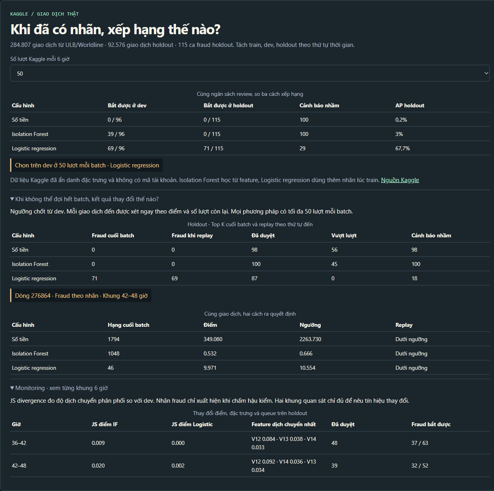

# Behavioral Anomaly Lab

[](https://github.com/Boothill2001/behavioral-anomaly-lab/actions/workflows/verify.yml)

**How many known frauds can an analyst queue catch with 50 review slots every six hours?** On held-out real transactions, the dev-selected logistic model caught **71 of 115** when it could rank a completed batch and **69 of 115** when each transaction had to be admitted on arrival. Isolation Forest caught **0 of 115** under either policy.

Download [the interactive demo](https://raw.githubusercontent.com/Boothill2001/behavioral-anomaly-lab/main/index.html) as `index.html` and open it in a browser. Use the Kaggle comparison to explore the measured queue and the simulator to inspect input and output at each pipeline step.

## Real transactions from Kaggle

The [ULB / Worldline Credit Card Fraud Detection dataset](https://www.kaggle.com/datasets/mlg-ulb/creditcardfraud) contains **284,807 transactions and 492 fraud labels**. Train on the first 24 relative hours, choose the method on the next 12 hours, and evaluate on the final 12 hours. Cap the queue at 50 reviews per six-hour batch. This yields 100 review slots per method on dev and 100 on holdout.

| Method | Dev fraud found | Holdout fraud found | Holdout false alerts | Holdout AP |
|---|---:|---:|---:|---:|
| Amount baseline | 0/96 | 0/115 | 100 | 0.17% |
| Isolation Forest | 39/96 | 0/115 | 100 | 2.97% |
| **Class-weighted logistic regression** | **69/96** | **71/115** | **29** | **67.69%** |

The two learned models use the same 28 anonymized components plus log amount. Logistic regression additionally receives labels during training. Top K on each finished batch measures ranking under a fixed retrospective review budget. The data spans two days and has no account IDs, label-availability timestamps, or analyst decisions. Training assumes the training labels had matured. The experiment cannot estimate production losses avoided or live review performance.

### Review as transactions arrive

Freeze each threshold on dev at the lowest score in its pooled top 100. During holdout, admit qualifying arrivals in timestamp and row-ID order until the six-hour quota fills. Compute outcomes after replay, once the historical labels are available for scoring.

| Method | Fraud caught | Reviews used / available | False alerts | Candidates lost to cap |
|---|---:|---:|---:|---:|
| Amount baseline | 0/115 | 98/100 | 98 | 56 |
| Isolation Forest | 0/115 | 100/100 | 100 | 45 |
| **Class-weighted logistic regression** | **69/115** | **87/100** | **18** | **0** |

**Inspect a miss.** Public dataset row **276864** is labeled fraud. It ranked **46th** in the batch under logistic regression and would have been reviewed by the batch policy. On arrival it scored **9.971**, below the frozen cutoff of **10.554**. An unused review slot did not change that decision.

### Monitor the score and the outcome separately

The dev-to-holdout drop from 39 Isolation Forest catches to zero warrants investigation. The replay reports score and feature distribution shifts using Jensen–Shannon divergence on dev-derived quantile bins. It also tracks cutoff pass volume, queue utilization, overflow, and eventual catches for each six-hour window. For example, V12 had the largest feature shift in both holdout batches. These are descriptive observations. With two batches, the report cannot establish why recall fell or attribute the change to concept drift.

Open the Kaggle comparison from the lab header to inspect both windows, change the retrospective review budget, and open the arrival-order replay. [Report and pinned archive checksum](kaggle-report.json)



## Behavioral walkthrough on simulated accounts

At a fixed budget of 50 manual reviews per day, a simple amount baseline found **168 of 663** simulated frauds. A behavioral Isolation Forest found **68 of 663**, including cases the baseline missed. The practical decision is to keep the baseline for this workload and use the case viewer to understand the tradeoff.

### One transaction, five steps

Open `index.html` and choose the first case. Transaction **285562** ranked **145th** by amount and **10th** by the behavioral model on April 30. Its amount was **2.37×** the observed account average. At a budget of 50, only the behavioral model sent it for review. The viewer also includes legitimate alerts, baseline-only catches, and missed fraud. A feature value describes the input to the model and does not establish which feature caused its score.

Follow the five steps from payment event to customer history, feature vector, anomaly score, daily queue and evaluation. Change the budget or scorer to compare the same transaction and the same holdout cohort. The experiment uses a retrospective end-of-day queue.


### What changed at the same review workload?

| Method | Dev fraud found | Holdout fraud found | Holdout false alerts | Precision@50/day | Recall@50/day | Holdout AP |
|---|---:|---:|---:|---:|---:|---:|
| Amount baseline | 148/571 | 168/663 | 182 | 48.0% | 25.3% | 27.50% |
| Isolation Forest, amount only | 42/571 | 46/663 | 304 | 13.1% | 6.9% | 6.04% |
| Isolation Forest, behavioral features | 37/571 | 68/663 | 282 | 19.4% | 10.3% | 5.48% |

All methods receive 350 review slots over seven holdout days. The selection metric is dev fraud found at 50 reviews per day. Behavioral features improved the Isolation Forest at this budget by 22 catches while its overall ranking AP fell. Compared with the amount baseline, the behavioral model adds 3 unique catches and misses 103 catches the baseline makes. The simulator injects fraud patterns in the amount distribution, so this result is specific to the simulation.

## Data and model

Public [Fraud Detection Handbook simulator data](https://github.com/Fraud-Detection-Handbook/simulated-data-raw), pinned to `6e67dbd0a3bfe0d7ec33abc4bce5f37cd4ff0d6a`. The official documentation describes the simulated fraud scenarios. This independent project uses no employer records or production measurements.

The first 35 daily batches contain 335,910 transactions. Timeline: April 1–7 for history warmup, April 8–21 for unlabeled model fitting, April 22–28 for development selection, and April 29–May 5 for holdout. For each transaction, the features use the current amount and strictly earlier events for the same customer: counts over 1h and 24h, total prior transactions, the ratio of amount to prior average, and terminal novelty. All history is scoped to the observed snapshot. The amount-only scorer uses log amount. Both forests use 100 trees, 256 observations per tree, and seed 42. Higher inverted score means more anomalous.

Labels enter offline evaluation. The queue selects the highest scores each day and uses transaction ID as the tie-breaker. The AP metric evaluates the full scored ranking. Each raw source file is verified against the pinned Git blob ID and its SHA-256 is recorded in [report.json](report.json). Cases are selected for illustration after scoring.

## Reproduce

Python 3.11. The first run downloads the two datasets.

```powershell
python -m pip install -r requirements.txt
python kaggle_benchmark.py
python experiment.py
python -m unittest -v test_experiment
```

Open the generated `index.html` directly in a browser. It embeds the measured results and case traces, so interaction works offline. Run `python experiment.py --render-only` after editing the UI.

GitHub Actions runs the unit tests and verifies that rebuilding the page from the checked-in reports produces the committed HTML. Raw data stays out of Git.
