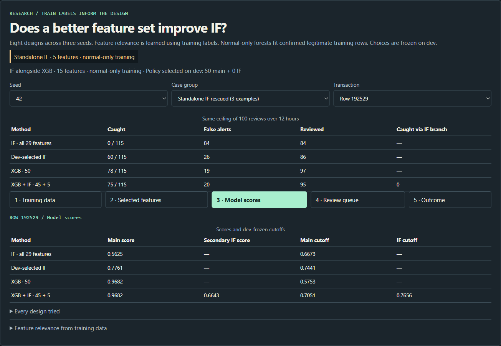
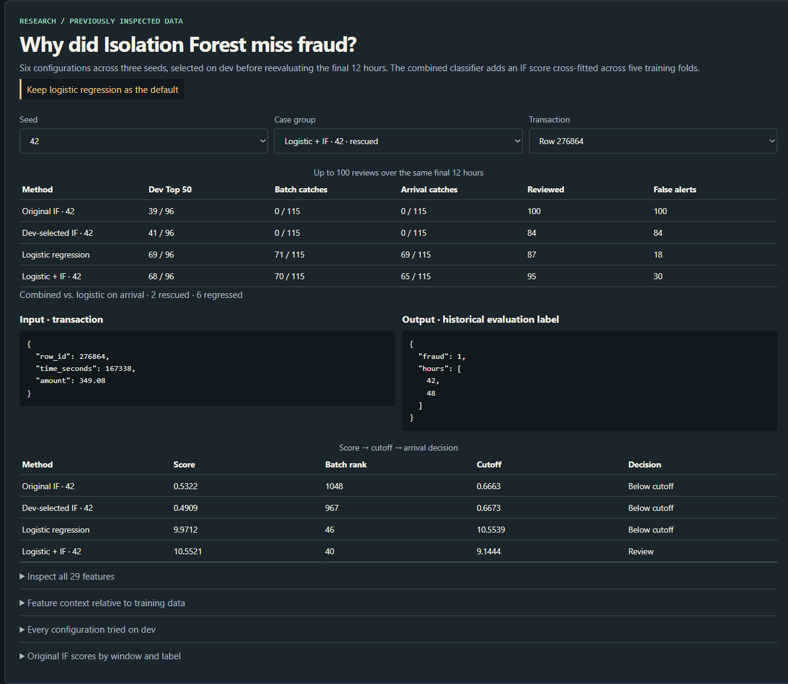
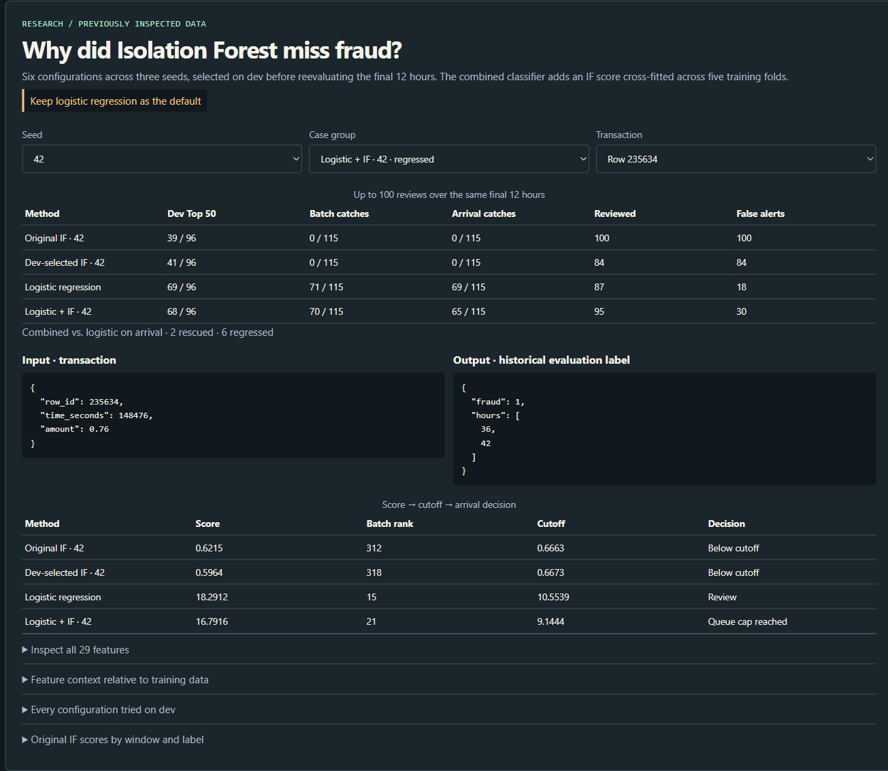
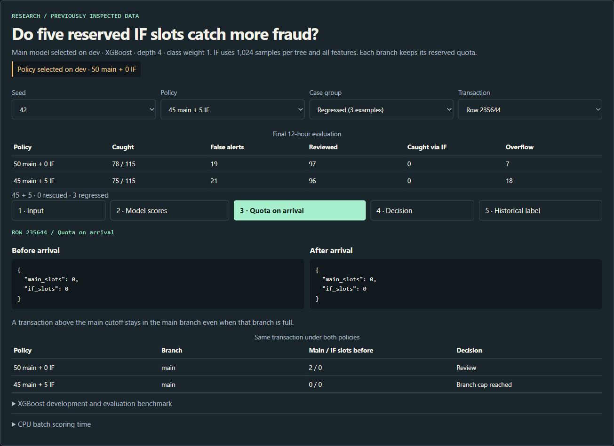
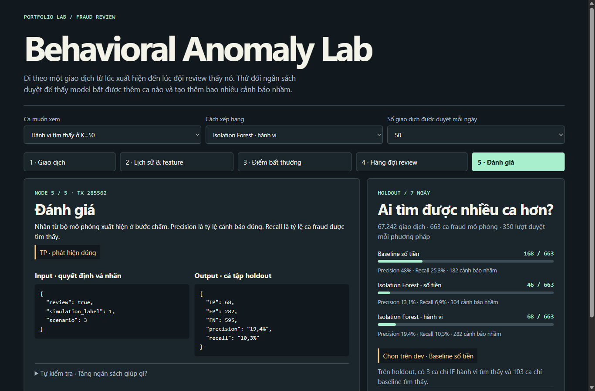

# Behavioral Anomaly Lab

**A fraud review queue has 50 slots every six hours. Which transactions should an analyst see, and what gets missed when that decision happens on arrival?**

I compared scoring methods on **284,807 real, anonymized card transactions** from ULB and Worldline. Selecting five features with training labels and fitting IF on confirmed normal transactions raised its arrival catches from **0/0/1 to 60/55/58 of 115 frauds** across three seeds. XGBoost remains the main model, catching **78/72/75**. These research rounds reuse the same previously inspected evaluation window. [IF feature experiment](#what-finally-improved-isolation-forest) · [Kaggle dataset](https://www.kaggle.com/datasets/mlg-ulb/creditcardfraud)

**Windows quick start.** Double-click `start.bat` and select **English** at the top of the demo. The app runs offline and requires no Python installation. You can also [download the interactive HTML](https://raw.githubusercontent.com/Boothill2001/behavioral-anomaly-lab/main/index.html) and open it directly.



## One transaction explains the tradeoff

On arrival, **transaction 276864** scored **9.971**. The review cutoff, set on development data, was **10.554**. The queue skipped it. By the end of its batch the same transaction ranked **46th**, so a batch policy reviewing the top 50 would have included it. The historical label confirmed fraud.

| Input | Score | Queue decision | Outcome |
|---|---|---|---|
| Anonymized card transaction 276864 | 9.971 from logistic regression | Skip on arrival because 9.971 is below 10.554 | Missed fraud |

In the logistic baseline on the same holdout, waiting for each batch to finish caught **71 frauds with 100 reviews**. Deciding on arrival caught **69 with 87 reviews**. In the replay, the cutoff mattered even with spare queue capacity.

## The original baseline decision

The amount baseline ranks by payment size. Isolation Forest learns an anomaly score from the inputs alone. Logistic regression uses the same inputs as Isolation Forest and also learns from confirmed labels. Both models score 28 anonymized components plus log amount.

| Method | Fraud caught on dev, batch queue | Fraud caught on holdout, batch queue | Fraud caught on holdout, arrival queue | False alerts, arrival queue |
|---|---:|---:|---:|---:|
| Amount baseline | 0/96 | 0/115 | 0/115 | 98 |
| Isolation Forest | 39/96 | 0/115 | 0/115 | 100 |
| **Class-weighted logistic regression** | **69/96** | **71/115** | **69/115** | **18** |

Logistic regression earned the highest development catch count at the fixed budget. Its holdout result supports carrying it forward when training labels are available. Isolation Forest's drop from 39 catches to zero motivates investigation. The demo shows score and feature distribution shifts, queue overflow, and confirmed catches by six-hour window. Two days of data cannot establish the cause of that drop or estimate production losses avoided.

## Could a better Isolation Forest rescue the missed transaction?

**It rescued the example and made the queue worse overall.** In a follow-up on the same inspected dataset, adding an IF score to logistic regression brought transaction **276864** into review. At seed 42 it also lost **six previously caught frauds**, including row **235634**, whose score exceeded the cutoff but arrived after the queue filled.

| Method | Seed | Fraud caught on arrival | False alerts | Reviews used |
|---|---:|---:|---:|---:|
| Logistic regression | Fixed baseline | **69/115** | **18** | 87 |
| Dev-selected IF | 42 / 43 / 44 | 0 / 0 / 1 | 84 / 82 / 79 | 84 / 82 / 80 |
| Logistic + IF score | 42 | 65/115 | 30 | 95 |
| Logistic + IF score | 43 | 65/115 | 26 | 91 |
| Logistic + IF score | 44 | 66/115 | 26 | 92 |

The default remains logistic regression. The combined candidate had to catch more fraud without adding false alerts across all three seeds. It failed that gate. This follow-up measures research progress on data already inspected.



<details>
<summary>See the regression that explains the rollout decision</summary>



</details>

**What the diagnostics revealed.** In the original IF, the 20 inspected false alerts scored **0.712–0.793**, while the 20 frauds nearest the top of the missed ranking scored **0.604–0.656**. The queue prioritized those legitimate outliers. A higher median fraud score than legitimate score still left the extreme top ranks full of false alerts. The demo shows score distributions by label and six-hour window, plus feature shifts for investigation.

**How the experiment ran.** Six IF configurations combine `max_samples` of 256, 1,024 or 4,096 with `max_features` of 0.5 or 1.0, using 100 trees and seeds 42/43/44. Selection maximizes mean dev catches at 50 reviews per batch, then minimizes seed variation and sample count. The selected configuration uses **1,024 samples and all features**, catching 41/43/42 dev frauds. Five shuffled training folds generate an IF feature for logistic regression, with every row scored by a forest fitted on the other folds. The complete training period precedes dev and evaluation. A full-train IF scores later rows. This assumes historical training labels are available.

Open the demo in English and select **Why did Isolation Forest miss fraud?** Choose a seed and a case group to inspect 20 original false alerts, 20 missed frauds, recovered cases, regressions, and persistent misses. Each case shows its 29 input features, score, rank, cutoff, queue decision and historical label.

[Development selection](if-dev-selection.json) · [Research results, seeds, paired changes and cases](if-research-report.json)

## Would XGBoost benefit from five IF review slots?

**XGBoost improved catches in this research round. The five IF slots caught zero frauds.** A depth-4 XGBoost model was selected on development arrival replay. On the previously inspected final 12 hours, the 50-slot policy caught **78/72/75 frauds** across seeds 42/43/44, compared with **69** for logistic regression. Reserving five slots for IF changed those results to **75/72/76**.

| Policy | Seed | Fraud caught / 115 | False alerts | Reviews used | Fraud caught via IF |
|---|---:|---:|---:|---:|---:|
| Logistic, 50 slots | Fixed baseline | 69 | 18 | 87 | 0 |
| XGBoost, 50 slots | 42 | 78 | 19 | 97 | 0 |
| XGBoost + IF, 45 + 5 | 42 | 75 | 21 | 96 | 0 |
| XGBoost, 50 slots | 43 | 72 | 28 | 100 | 0 |
| XGBoost + IF, 45 + 5 | 43 | 72 | 23 | 95 | 0 |
| XGBoost, 50 slots | 44 | 75 | 25 | 100 | 0 |
| XGBoost + IF, 45 + 5 | 44 | 76 | 18 | 94 | 0 |

**Inspect the cost of reservation.** At seed 42, fraud row **235644** reached the 50-slot queue with two main slots remaining. Under 45 + 5, the main quota was already full, so the same row was skipped. Meanwhile legitimate row **195218** occupied an IF slot. The policy caught three fewer frauds and generated two more false alerts.

The extra catch at seed 44 came through the main branch, whose cutoff also changes when capacity changes. Each reserved IF branch caught zero frauds. The chosen policy remains **50 main + 0 IF**, following the development gate.



Open **XGBoost and the 45 + 5 review queue** in the English demo. Choose a seed, policy, and example, then step through **input → model scores → quota on arrival → decision → historical label**. The comparison shows both policies on the same transaction. Empty example groups explicitly show zero cases.

<details>
<summary>Model selection, cutoffs, and reproducibility</summary>

The six XGB configurations combine depth 2/4/6 with class weight 1 or the negative-to-positive training ratio. Each uses 200 trees, learning rate 0.05, row and column sampling of 0.8, CPU histogram training, two threads, and seeds 42/43/44. The main model maximizes mean dev arrival catches, breaking ties by false alerts, seed variation and simpler configuration. It selected depth 4 with class weight 1. The learned scores are used for ranking and thresholding.

For 50 + 0, the cutoff is the lowest score in the pooled dev top 100. For 45 + 5, the main cutoff comes from dev top 90. The IF cutoff comes from the top 10 IF scores among development transactions below the new main cutoff. A main-qualified arrival stays in the main branch even if its quota is full. Reserved capacity resets every six hours, and slots stay in their assigned branch. Only valid, finite features enter scoring.

The 45 + 5 policy must catch more fraud without increasing false alerts at every seed on dev. The runner records the chosen model, cutoffs and policy before scoring the final window. Full candidate comparisons include retrospective Top K, arrival outcomes, AP and ten measurements of 1,024-row CPU scoring after warmup. The timing covers model prediction calls.

[Development selection and policy cutoffs](xgb-queue-selection.json) · [Complete research report and case traces](xgb-queue-report.json)

</details>

## What finally improved Isolation Forest?

**Transaction 192529 had an amount of 1.00 and a confirmed fraud label.** At seed 42, the 29-feature forest scored it **0.5625**, below its **0.6673** cutoff. The selected five-feature forest scored it **0.7761**, above its own **0.7441** cutoff, and admitted it for review.

I tested two changes independently across three seeds: use the top 5/10/15 features instead of all 29, and fit IF on confirmed legitimate training rows instead of the entire training period. Feature relevance came from mutual information with the training labels. Standalone selection maximized development arrival catches at the same review capacity.

| IF design | Fraud caught on arrival, seeds 42 / 43 / 44 | False alerts |
|---|---:|---:|
| All 29 features, all training rows | 0 / 0 / 1 | 84 / 82 / 79 |
| All 29 features, normal-only training | 0 / 0 / 0 | 82 / 76 / 73 |
| Top 5 features, all training rows | 49 / 53 / 67 | 40 / 28 / 13 |
| **Top 5 features, normal-only training, selected on dev** | **60 / 55 / 58** | **26 / 36 / 28** |

The selected features were **V17, V14, V12, V10 and V11**. Keeping all 29 features while changing the training population alone did little. Selecting five features changed the result substantially. Normal-only training had mixed effects across seeds, so the ablation reports every design. The dev-selected candidate remained fixed even though another design scored better on evaluation at one seed.

**This design uses labels.** Labels choose the feature subset, and confirmed legitimate labels define the normal-only fitting population. The experiment therefore evaluates label-informed novelty detection. Training labels are assumed to have matured. It does not establish detection of novel fraud types or performance on a fresh dataset.

**Did it earn five slots alongside XGB?** A separate development objective chose a 15-feature, normal-only IF for the secondary branch. That branch caught zero frauds on the final window, and the combined policy failed the development gate. Improving standalone IF did not establish added value over XGB under the tested five-slot allocation.

In the demo, open **Does a better feature set improve IF?** and select the **Standalone IF rescued** group. Inspect the fitting population, selected features, scores, queue state and historical label. The full table includes all eight designs.

[Frozen feature selection](if-feature-selection.json) · [Research results and transaction traces](if-feature-report.json)

## Follow account behavior through the pipeline

The Kaggle data has anonymized inputs and no account IDs. A [public transaction simulator](https://github.com/Fraud-Detection-Handbook/simulated-data-raw) supplies account history for the walkthrough. It shows the inputs and outputs of all five steps.

**Payment event → prior account history → anomaly score → review decision → evaluation**

Start with **transaction 285562**. Its payment was **2.37×** the account's prior average. The behavior model ranked it **10th**, compared with **145th** by amount. Toggle the scorer to see how it moves in and out of the 50-slot queue. Across seven held-out days, the amount baseline still caught **168 of 663** simulated frauds, versus **68 of 663** for behavioral Isolation Forest. The individual case shows where behavior helped. The cohort result explains why the baseline stayed the default on this simulator.

<details>
<summary>See the five-step walkthrough</summary>



</details>

## Evaluation and reproduction

<details>
<summary>Time splits, score cutoffs, and data checks</summary>

- **Kaggle.** The source includes 492 labeled frauds over two days. Fit on relative hours 0–24, select on 24–36, and evaluate on 36–48. Each six-hour batch allows up to 50 reviews. Set each arrival cutoff to the lowest score in the pooled development top 100. During replay, admit qualifying transactions in timestamp and row-ID order, subject to the six-hour cap. Historical training labels are assumed to have matured. The source lacks label-availability timestamps and analyst decisions. [Report and pinned archive checksum](kaggle-report.json)
- **Monitoring.** Compare development and holdout score and feature distributions using Jensen–Shannon divergence on development quantile bins. Review counts and eventual fraud catches come from the replay. This is retrospective monitoring.
- **Simulator.** Use 35 daily batches totaling 335,910 rows. The first 7 days warm up history, the next 14 fit the forests, the following 7 select the method, and the final 7 evaluate it. Feature history is strictly earlier than each event. The forests use 100 trees, 256 samples per tree, and seed 42. Source files are pinned and checked before parsing. [Report and source checksums](report.json)

</details>

Run with Python 3.11. Both datasets download on the first run.

```powershell
python -m pip install -r requirements.txt
python kaggle_benchmark.py
python experiment.py
python -m unittest discover -v
```

Open `index.html`. It embeds the reports and works offline. [GitHub Actions](https://github.com/Boothill2001/behavioral-anomaly-lab/actions/workflows/verify.yml) runs the unit tests and checks that rebuilding the demo from the committed reports produces the same HTML.

To reproduce the IF follow-up, run `python if_research.py`, followed by `python experiment.py --render-only`. The runner writes the dev selection before scoring the final 12 hours and saves a separate research report. Opening the demo with `start.bat` uses the saved results.

To reproduce the XGB and quota comparison, run `python queue_experiment.py`, followed by `python experiment.py --render-only`. This research round uses the same previously inspected two-day dataset.

To reproduce feature selection and normal-only IF fitting, run `python if_feature_study.py`, followed by `python experiment.py --render-only`. Feature relevance uses only the first 24 hours of training labels. Model and secondary-branch choices are saved from development results before evaluating the last 12 hours.
